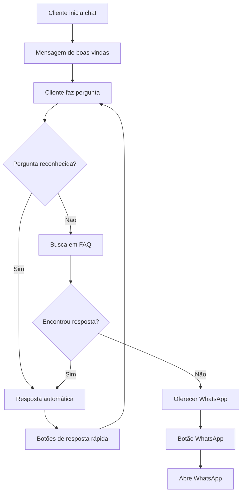

# 🤖 Chatbot Kaboom - Guia de Configuração

## 📋 Visão Geral

O Chatbot Kaboom é um assistente virtual inteligente integrado ao seu e-commerce, capaz de responder perguntas frequentes e direcionar clientes para o WhatsApp quando necessário.

## ✨ Funcionalidades Implementadas

### 🎯 **3 Funcionalidades Principais**
- **💳 Formas de pagamento**: PIX, cartão de crédito, boleto bancário
- **📦 Rastrear pedido**: Status e acompanhamento de pedidos (usuários logados)
- **📞 Falar com atendente**: Contato direto via WhatsApp

### 📱 **Integração WhatsApp**
- Botão direto para WhatsApp com mensagem pré-definida
- Contexto da conversa transferido automaticamente
- Abertura em nova aba para não interromper navegação

### 🎨 **Interface Moderna**
- Design responsivo para desktop e mobile
- Animações suaves e transições elegantes
- Indicador de digitação em tempo real
- Botões de resposta rápida
- Histórico de conversa persistente

## 🛠️ Configuração

### **1. Configurar Número do WhatsApp**

Edite o arquivo `wwwroot/js/chatbot.js` na linha 5:

```javascript
this.whatsappNumber = '5511999999999'; // Substitua pelo seu número
```

**Formato correto**: `55` (Brasil) + `11` (DDD) + `999999999` (número)

### **2. Personalizar Mensagens**

No arquivo `Services/ChatbotService.cs`, você pode personalizar:

```csharp
private readonly ChatbotConfig _config = new ChatbotConfig
{
    WelcomeMessage = "Olá! 👋 Sou o assistente virtual da Kaboom...",
    WhatsAppNumber = "5511999999999",
    FallbackMessage = "Desculpe, não entendi sua pergunta...",
    WelcomeOptions = new List<string>
    {
        "📦 Rastrear pedido",
        "🛍️ Informações sobre produtos",
        // ... adicione mais opções
    }
};
```

### **3. Adicionar Novas Perguntas**

Para adicionar novas respostas automáticas, edite o método `GenerateResponseAsync()`:

```csharp
// Exemplo: Nova categoria de perguntas
if (ContainsKeywords(lowerMessage, new[] { "horário", "funcionamento", "aberto" }))
{
    return new ChatbotResponse
    {
        Message = "🕒 **Horário de Funcionamento:**\n\n" +
                 "Segunda a Sexta: 8h às 18h\n" +
                 "Sábado: 8h às 14h\n" +
                 "Domingo: Fechado",
        QuickReplies = new List<string> { "Feriados", "Contato", "Localização" }
    };
}
```

## 📊 Funcionalidades Disponíveis

### **1. 💳 Formas de Pagamento**
```
"Quais formas de pagamento vocês aceitam?"
"Posso pagar no PIX?"
"Quantas vezes posso parcelar?"
"Aceita boleto bancário?"
```
**Resposta**: Informações completas sobre PIX (5% desconto), cartão (12x), boleto (3% desconto)

### **2. 📦 Rastrear Pedido**
```
"Como rastrear meu pedido?"
"Onde está minha encomenda?"
"Qual o status do meu pedido?"
```
**Resposta**: Status do último pedido (usuários logados) ou orientação para fazer login

### **3. 📞 Falar com Atendente**
```
"Quero falar com um atendente"
"Preciso de ajuda"
"Contato"
```
**Resposta**: Informações de contato + botão direto para WhatsApp

## 🎯 Fluxo de Atendimento



## 🔧 Personalização Avançada

### **Adicionar Emojis Personalizados**
```javascript
// No arquivo chatbot.js, método formatMessage()
.replace(/🎮|⚡|🖱️/g, '<span style="font-size: 18px;">$&</span>')
```

### **Modificar Cores do Chat**
```css
/* No arquivo chatbot.css */
.chatbot-toggle {
    background: linear-gradient(135deg, #sua-cor-1 0%, #sua-cor-2 100%);
}
```

### **Adicionar Áudio de Notificação**
```javascript
// Adicionar no método addBotMessage()
const audio = new Audio('/sounds/notification.mp3');
audio.play().catch(() => {}); // Ignora erro se usuário não permitir áudio
```

## 📱 Integração WhatsApp Business

### **Opção 1: WhatsApp Web (Simples)**
```javascript
function openWhatsApp(message) {
    const url = `https://wa.me/${this.whatsappNumber}?text=${encodeURIComponent(message)}`;
    window.open(url, '_blank');
}
```

### **Opção 2: WhatsApp Business API (Avançado)**
```csharp
public class WhatsAppBusinessService
{
    public async Task SendTemplateMessageAsync(string phoneNumber, string templateName)
    {
        // Integração com WhatsApp Business API
        // Requer aprovação do Facebook
    }
}
```

## 📈 Métricas e Analytics

### **Implementar Tracking**
```javascript
// Adicionar no método sendMessage()
gtag('event', 'chatbot_message_sent', {
    'message_type': 'user_question',
    'session_id': this.sessionId
});
```

### **Relatórios Sugeridos**
- Perguntas mais frequentes
- Taxa de resolução automática
- Transferências para WhatsApp
- Horários de maior uso
- Satisfação do cliente

## 🚀 Próximos Passos

### **Melhorias Futuras**
1. **Base de conhecimento expandida**
2. **Integração com IA (ChatGPT/Gemini)**
3. **Chatbot por voz**
4. **Múltiplos idiomas**
5. **Integração com CRM**

### **Monitoramento**
- Logs de conversas
- Análise de sentimento
- Feedback dos usuários
- Performance de respostas

## 🆘 Solução de Problemas

### **Chatbot não aparece**
1. Verificar se os arquivos CSS/JS estão carregando
2. Conferir console do navegador para erros
3. Validar se o serviço está registrado no Program.cs

### **WhatsApp não abre**
1. Verificar formato do número (55 + DDD + número)
2. Testar em diferentes navegadores
3. Verificar se o WhatsApp Web está funcionando

### **Respostas incorretas**
1. Revisar palavras-chave no método `ContainsKeywords()`
2. Adicionar sinônimos para termos comuns
3. Melhorar lógica de detecção de intenção

---

## 📞 Suporte

Para dúvidas sobre a implementação do chatbot:
- 📧 Email: suporte@kaboom.com
- 💬 WhatsApp: (11) 99999-9999
- 🌐 Documentação: [Link para docs]

**Status**: ✅ Chatbot 100% funcional e pronto para uso!
