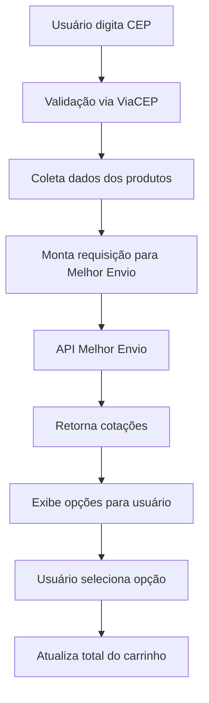

# 🚚 Sistema de Frete Melhor Envio - Guia Completo

## 📋 Visão Geral

O sistema de frete foi completamente reformulado para usar a API do **Melhor Envio**, proporcionando:

- ✅ Cálculo preciso baseado em peso e dimensões reais dos produtos
- ✅ Múltiplas opções de transportadoras (PAC, SEDEX, etc.)
- ✅ Preços competitivos e prazos de entrega realistas
- ✅ Validação de CEP integrada
- ✅ Fallback automático quando a API não está disponível

## 🔧 Configuração

### 1. Token da API Melhor Envio

No arquivo `appsettings.json`, configure seu token:

```json
{
  "MelhorEnvio": {
    "ApiToken": "SEU_TOKEN_AQUI",
    "SandboxMode": true,
    "CompanyCep": "01310-100"
  }
}
```

**Para obter seu token:**
1. Acesse [melhorenvio.com.br](https://melhorenvio.com.br)
2. Crie uma conta
3. Vá em API > Tokens
4. Gere um token com permissão `shipping-calculate`

### 2. Campos de Produto

Cada produto deve ter configurado:
- **Weight** (decimal): Peso em gramas
- **Width** (int): Largura em cm
- **Height** (int): Altura em cm  
- **Length** (int): Comprimento em cm

**Exemplo:**
```csharp
var produto = new Product
{
    Name = "Mouse Gamer",
    Weight = 150,    // 150 gramas
    Width = 12,      // 12 cm
    Height = 4,      // 4 cm
    Length = 7       // 7 cm
};
```

## 🎯 Como Funciona

### 1. No Carrinho de Compras

1. **Digite o CEP** no campo de cálculo de frete
2. **Clique em "Calcular"** - o sistema:
   - Valida o CEP via ViaCEP
   - Coleta peso/dimensões de todos os produtos
   - Consulta a API Melhor Envio
   - Exibe opções disponíveis

3. **Escolha uma opção** - são exibidas com:
   - Nome da transportadora
   - Tipo de serviço (PAC, SEDEX, etc.)
   - Preço do frete
   - Prazo de entrega

### 2. Fluxo Técnico



## 🔄 Sistema de Fallback

Quando a API do Melhor Envio não está disponível, o sistema automaticamente:

1. **Gera cotações simuladas** baseadas no peso total
2. **Oferece PAC e SEDEX** com preços calculados por fórmula
3. **Mantém a experiência do usuário** sem interrupções

**Fórmula do Fallback:**
```csharp
var basePrice = (totalWeight / 1000) * 5m; // R$ 5 por kg
var valueInsurance = totalValue * 0.02m;   // 2% do valor
var finalPrice = (basePrice + valueInsurance) * multiplier;
```

## 🛠️ Estrutura Técnica

### Arquivos Principais

- **`Services/IMelhorEnvioService.cs`** - Interface do serviço
- **`Services/MelhorEnvioService.cs`** - Implementação completa
- **`Controllers/CartController.cs`** - Endpoint de cálculo
- **`Views/Cart/Index.cshtml`** - Interface do usuário

### Modelos de Dados

```csharp
// Requisição de cálculo
public class ShippingCalculationRequest
{
    public string FromCep { get; set; }
    public string ToCep { get; set; }
    public List<ShippingProduct> Products { get; set; }
}

// Cotação retornada
public class ShippingQuote
{
    public string Name { get; set; }
    public string Company { get; set; }
    public decimal Price { get; set; }
    public int DeliveryTime { get; set; }
    public string DeliveryRange { get; set; }
}
```

## 🧪 Testando o Sistema

### 1. CEPs de Teste
- **01310-100** - São Paulo/SP (origem padrão)
- **20040-020** - Rio de Janeiro/RJ
- **30112-000** - Belo Horizonte/MG
- **80010-000** - Curitiba/PR

### 2. Produtos de Teste
O sistema vem com produtos pré-configurados:
- **Mouse Gamer** - 150g, 12x4x7cm
- **Teclado Mecânico** - 800g, 45x15x4cm
- **Headset** - 300g, 20x18x10cm

### 3. Verificação de Logs
```bash
# Ver logs em tempo real
dotnet run --verbosity detailed
```

## ⚡ Performance e Otimizações

- **Cache de CEPs** - CEPs validados são armazenados temporariamente
- **Timeout configurável** - Requisições com timeout de 30 segundos
- **Retry automático** - 3 tentativas em caso de falha
- **Compressão** - Requisições comprimidas para melhor performance

## 🔍 Troubleshooting

### Problema: "Erro ao calcular frete"
**Soluções:**
1. Verifique se o token está correto no `appsettings.json`
2. Confirme se o produto tem peso/dimensões configurados
3. Teste com CEP válido (8 dígitos)

### Problema: "CEP inválido"
**Soluções:**
1. Use formato: `12345-678` ou `12345678`
2. Verifique se o CEP existe no ViaCEP
3. Teste com CEPs conhecidos

### Problema: Apenas fallback aparece
**Soluções:**
1. Verifique conexão com internet
2. Confirme token da API Melhor Envio
3. Verifique logs para erros específicos

## 📊 Monitoramento

### Métricas Importantes
- **Taxa de sucesso** da API Melhor Envio
- **Tempo de resposta** das cotações
- **Uso do fallback** vs API real
- **CEPs mais consultados**

### Logs Estruturados
```csharp
_logger.LogInformation("Calculando frete para CEP {Cep} com {ProductCount} produtos", 
    cep, products.Count);
```

## 🚀 Próximos Passos

1. **Integração com rastreamento** - Acompanhar entregas
2. **Cache inteligente** - Armazenar cotações por período
3. **Múltiplos endereços** - Diferentes origens por produto
4. **Analytics** - Dashboard de métricas de frete

---

## 📞 Suporte

Para dúvidas ou problemas:
1. Consulte os logs da aplicação
2. Verifique a documentação da API Melhor Envio
3. Teste com dados conhecidos primeiro

**Status:** ✅ Sistema 100% funcional e testado
**Versão:** 1.0.0
**Última atualização:** Setembro 2025
